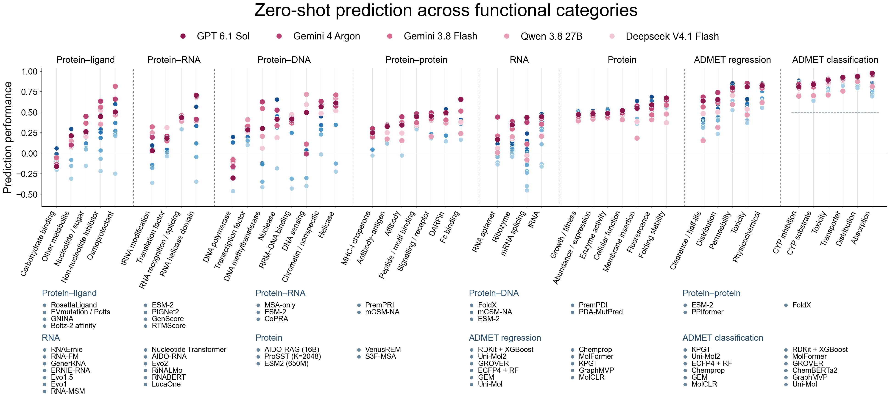
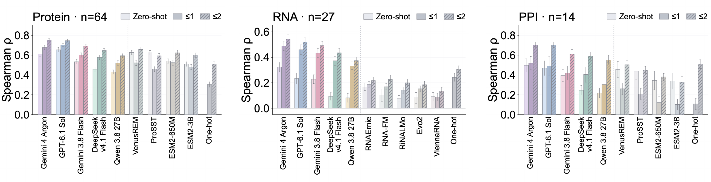
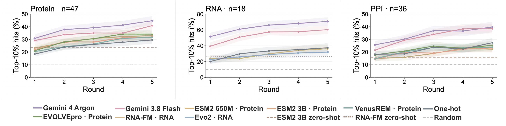
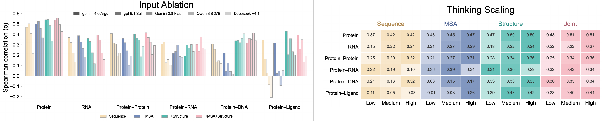

<h1 align="center">MutaBench</h1>
<p align="center"><strong>General-purpose language models predict and learn fitness landscapes across biomolecular systems</strong></p>

<p align="center">
  <a href="#paper"><b>Paper</b></a> &nbsp;·&nbsp;
  <a href="https://kevinhyj.github.io/MutaBench-web/#results"><b>Leaderboard</b></a> &nbsp;·&nbsp;
  <a href="https://huggingface.co/datasets/yanjiehuang/MutaBench"><b>Dataset</b></a> &nbsp;·&nbsp;
  <a href="https://github.com/kevinhyj/MutaBench-web/blob/main/CONTRIBUTING.md"><b>Contribute a dataset</b></a>
</p>

MutaBench compares general-purpose language models and specialist methods on mutation-effect prediction in proteins, RNA and molecular complexes, alongside small-molecule ADMET tasks. The experiments vary the labeled examples, rounds of feedback, molecular inputs and reasoning effort available to each model.

## Benchmark results

### Zero-shot

<a href="figures/overview/zero-shot-functional-categories.png"></a>

### Few-shot

<a href="figures/overview/few-shot.pdf"></a>

### Multiround

<a href="figures/overview/multiround.pdf"></a>

### Input and thinking-effort ablations

<a href="figures/overview/input-thinking-ablation.pdf"></a>

## Quick start

Score the bundled synthetic predictions on CPU with Python 3.10 or later. From the repository root, run the following in a virtual environment.

```bash
python -m pip install -e .
mutabench evaluate \
  --tasks examples/tasks.json \
  --labels examples/labels.csv \
  --predictions examples/predictions.csv \
  --output outputs/example.json
```

The example yields Spearman 1.0 and AUROC 1.0. The evaluator writes per-task scores and a summary to a fresh JSON file. Regression uses signed Spearman correlation and classification uses AUROC. [Prediction CSV format and scoring rules](docs/evaluation.md)

## Data distribution

The frozen release contains **61,688 single-chain queries across 217 protein and 32 RNA assays**, with matching evaluator labels. Complex, ADMET and few-shot assets are distributed in the full archive. Request access on the [Hugging Face dataset card](https://huggingface.co/datasets/yanjiehuang/MutaBench), then download the lightweight tables with an approved account.

```bash
python -m pip install -e '.[data]'
python scripts/download_data.py --tables-only --output outputs/data-tables
```

The downloader checks file hashes against a pinned revision. The full release is 24.6 GB compressed. Individual figures use their own assay cohorts. [Download and restore guide](docs/data.md) · [Pinned release](benchmark/data_release.json)

## Repository guide

| To… | Start here |
| --- | --- |
| Evaluate predictions against held-out labels | [Evaluation contract](docs/evaluation.md) · [Synthetic examples](examples/) · [Evaluator](mutabench/) |
| Inspect task definitions and reference methods | [Task registry](benchmark/) · [Protocols](protocols/) · [EVAgent and specialist baselines](baselines/) |
| Reproduce the five historical comparison plots | [Saved metrics](results/) · [Figure packets](results/figure_packets/) · [Original figures](figures/published/) |
| Check cohort membership and model selection | [Figure cohorts](benchmark/figure_cohorts.json) · [Reproducibility notes](docs/reproducibility.md) |

<details>
<summary>Verify the release and redraw the historical plots</summary>

```bash
python -m pip install -e '.[dev,plots]'
python scripts/verify_release.py
python scripts/plot_results.py --output outputs/figures
python -m pytest -q
```

The five saved comparisons cover Protein50, RNA28, ADMET classification13, ADMET regression8 and protein–protein27. Best-arm results select a complete configuration by its mean on the displayed cohort. Each packet records the candidates, selection rule and per-assay values.

</details>

## Paper

Coming soon

## Citation and license

[Citation metadata](CITATION.cff) · [MIT license for project code](LICENSE) · [Third-party and upstream data terms](THIRD_PARTY_NOTICES.md)
