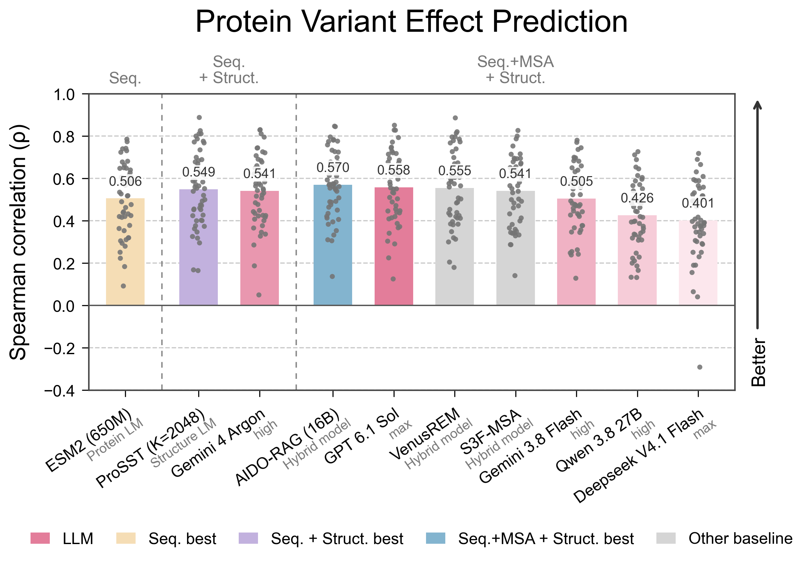

# MutaBench

MutaBench provides evaluation protocols, reference implementations and saved
results for biomolecular variant-effect prediction. Tasks span proteins, RNA,
and protein complexes with protein, RNA, DNA or small-molecule partners. ADMET
classification and regression are tracked separately as molecular-property
tasks, rather than treated as mutation landscapes.

This first code release separates the benchmark interface from the EVAgent
reference method. You can evaluate another model's predictions without an API
key, an agent framework or a GPU.

**Release status:** code, task metadata, saved metrics and five historical
comparison figures are included. Full sequences, independent evaluation labels,
MSA, structures, feature bundles and raw prediction archives are not bundled
in Git. The separate dataset release is being prepared; see
[`benchmark/data_release.json`](benchmark/data_release.json). This checkout
supports the synthetic evaluation example and saved-result reproduction. It
does not yet provide an end-to-end download of every research experiment.

## Quick start

Python 3.10 or later:

```bash
python -m venv .venv
source .venv/bin/activate
python -m pip install -e '.[dev,plots]'

mutabench evaluate \
  --tasks examples/tasks.json \
  --labels examples/labels.csv \
  --predictions examples/predictions.csv \
  --output outputs/example.json

python scripts/verify_release.py
python scripts/plot_results.py --output outputs/figures
python -m pytest -q
```

The example is entirely synthetic and is not a scientific benchmark result.
Output paths must be new. None of these commands calls a model or reads private
research files.

## Contents

| Path | Contents |
| --- | --- |
| [`mutabench/`](mutabench/) | Model-independent CSV evaluation and CLI |
| [`benchmark/`](benchmark/) | Registered task identities, candidate order, hashes, figure cohorts and release metadata |
| [`protocols/`](protocols/) | Sampling, evidence, prompt and evaluation contracts; original zero-shot reference code |
| [`baselines/`](baselines/) | EVAgent source, single-chain adapters and historical model catalog |
| [`results/`](results/) | Saved single-chain/ADMET metrics and current comparison packets |
| [`figures/`](figures/) | Original SVG, PNG and PDF comparison figures |
| [`examples/`](examples/) | Synthetic tasks, independent labels and prediction format |
| [`docs/`](docs/) | Evaluation, data distribution and reproducibility notes |

The registered single-chain source pool has **217 protein assays and 32 RNA
assays**. Registration, eligibility, evidence availability, completed model
coverage and a particular figure's paired cohort are distinct quantities.
These 249 registered tasks are not the denominator of every comparison.

## Evaluation contract

Prediction CSVs use `task_id,variant_id,score`, with optional `model,condition`
columns. Identities are matched within the complete task namespace, independently
of CSV order. Larger predicted scores always mean a larger outcome in the
declared target direction. Regression tasks explicitly declare whether larger
source labels are better; classification uses label 1 as the positive class.

The evaluator reports signed Spearman for regression and tie-aware AUROC for
classification. Incomplete tasks are not scored, undefined metrics stay null,
and available task scores receive equal weight within each domain and metric.
Missing predictions are never filled with zero. Group means with different
completed task sets require a matched-task comparison before interpreting model
differences. See [the evaluation format](docs/evaluation.md).

Measured support examples and query labels remain separate. A prediction method
may read only the support outcomes allowed by its frozen protocol; the independent
evaluator reads query labels after predictions have been saved.

## Saved comparisons

The current saved figure packets cover Protein50, RNA28, ADMET classification13,
ADMET regression8 and protein–protein27. Each packet includes the exact assay
cohort and the per-assay values underlying every bar.



Best-arm figures select a complete arm/thinking configuration by its mean on
the displayed cohort. This is **descriptive selection on that same cohort**,
not held-out hyperparameter selection or an independent leaderboard result.
Selection rules and candidate arms are retained in the packets. The incomplete
DeepSeek1017 pilot is not merged into the full-cohort results.

`scripts/plot_results.py` redraws these numeric packets using portable Matplotlib
styles. Byte-identical historical publication figures are in
[`figures/published/`](figures/published/). See
[reproducibility and limitations](docs/reproducibility.md).

## Data distribution

GitHub holds code, protocols, lightweight manifests, synthetic examples and result
summaries. Hugging Face Datasets is the intended home for the full reviewed data
release. The dataset identifier, immutable revision and file checksums will be
recorded in `benchmark/data_release.json` once that release is available.

Upstream datasets retain their own terms. Private cohorts, credentials, installed
environments, vendor source and separately licensed executables are excluded
from this code release. A filename containing `public` is not a redistribution
license. See [data distribution](docs/data.md) and
[third-party notices](THIRD_PARTY_NOTICES.md).

## Reference methods

EVAgent retains its own Python package under [`baselines/evagent/`](baselines/evagent/).
Shared zero-shot protocol implementations are under
[`protocols/zeroshot/`](protocols/zeroshot/). They document historical protocol
versions; the original research runners were not all a single unified harness.
Some legacy preparation paths require separately released assets or external
tools. See the component READMEs before running them.

## Citation and license

Repository citation metadata is in [`CITATION.cff`](CITATION.cff). Publication
metadata will be added when finalized. Project-owned code is distributed under
the [MIT license](LICENSE); this does not relicense upstream data, model weights,
tools or dependencies.

